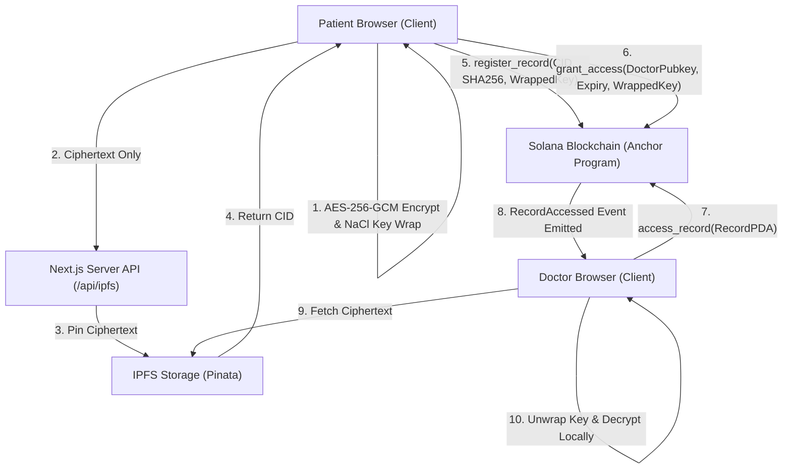

# SolHealth

SolHealth is a patient-controlled decentralized medical records protocol built on Solana with client-side encryption and IPFS storage. Patients encrypt sensitive medical documents locally in the browser using AES-256-GCM and wrap encryption keys with TweetNaCl Box for authorized recipients. Encrypted ciphertexts are pinned to IPFS while document hashes, IPFS content identifiers (CIDs), and time-bounded access delegations are enforced on-chain via Solana Program Derived Addresses (PDAs). Every state transition—from credential issuance to access grant and revocation—emits immutable on-chain events for verification and auditing.

## Architecture



The browser encrypts the raw medical payload using AES-256-GCM with a freshly generated 256-bit symmetric key, then wraps that symmetric key using NaCl box (Curve25519) for the recipient public key. The ciphertext alone is sent to an internal server route that pins it to IPFS without ever seeing plaintext or cryptographic keys. The patient registers the IPFS CID, SHA-256 integrity hash, and wrapped key on Solana in a Record PDA. The patient delegates access by creating an Access PDA with an expiration timestamp and doctor-specific wrapped key. A credentialed doctor executes an on-chain access transaction, fetches ciphertext from IPFS, un-wraps the AES key, and decrypts the document in memory while every action emits an immutable on-chain event.

## What is Implemented

The following features are fully implemented and verified in the codebase:
- Issuer-backed doctor credentials stored on-chain as Program Derived Addresses (PDAs).
- Client-side browser-safe encryption (AES-256-GCM) and public key wrapping (X25519 / TweetNaCl).
- Server-side IPFS pinning relay via Pinata accepting only encrypted ciphertext payloads.
- On-chain medical record registration storing CID, SHA-256 content hash, and wrapped key.
- Time-bounded access delegation with on-chain timestamp expiry and instant revocation.
- Smart contract permission enforcement preventing revoked, expired, or non-credentialed access.
- Cryptographic tamper detection comparing downloaded ciphertext checksums against on-chain hashes.
- Comprehensive audit log timeline with CSV export and Solana Explorer transaction links.
- Automated benchmark suites for local validator and live Solana Devnet environments.

## Trust Model and Limitations

This implementation maintains the following operational assumptions and technical boundaries:
- Demo Role Storage: Demo keypairs are stored unencrypted in browser localStorage for testing purposes, rather than in hardware wallets or external browser extension apps.
- Trusted Authority: The root configuration relies on a designated authority public key to issue doctor credentials.
- External Storage Dependency: Document persistence depends on Pinata IPFS availability and gateway reachability.
- Decrypted Data Boundaries: On-chain revocation prevents future decryption key retrieval and access execution; however, revoking access cannot retroactively erase data that a doctor already decrypted and saved locally.
- Public Metadata: While document payloads are encrypted, Solana transaction history exposes public wallet addresses, account PDAs, and interaction timestamps.
- Credential Representation: Doctor credentials are implemented as lightweight Anchor account PDAs, not Metaplex Soulbound Tokens (SBTs).
- Performance Benchmarks: Latencies and fees recorded on local validator and Devnet reflect isolated slot times and public RPC conditions; neither represents Solana Mainnet production performance.

## Future Work

The following items are design goals for future iterations and are not claimed as implemented:
- Zero-knowledge emergency access verification (Circom / SnarkJS circuits with hospital multi-sig triggers and replay protection).
- Native wallet-app integration (Phantom, Solflare) utilizing deterministic BIP-44 key derivation.
- ABDM (Ayushman Bharat Digital Mission) and FHIR (Fast Healthcare Interoperability Resources) data schema conformance.
- Formal DPDP (Digital Personal Data Protection Act) statutory privacy impact assessment.
- Mainnet deployment with stake-weighted quality of service (SWQoS).
- Redundant decentralized pinning across multiple independent IPFS cluster nodes.
- Social key recovery schemes and Hardware Security Module (HSM) signing integration.

## Prerequisites and Setup

### Environment Requirements
- Rust: `1.89.0` or later
- Solana CLI: `4.0.2` (Agave) or compatible
- Anchor CLI: `1.0.0`
- Node.js: `v24.14.1` or later (`npm` / `yarn`)

### Setup Instructions

1. Clone the repository:
   ```bash
   git clone https://github.com/Akshat0125/SolHealth.git
   cd SolHealth
   ```

2. Install root and application dependencies:
   ```bash
   npm install
   cd app && npm install && cd ..
   ```

3. Configure environment variables:
   ```bash
   cp app/.env.example app/.env.local
   ```
   Edit `app/.env.local` to provide your Pinata JWT:
   ```env
   PINATA_JWT=your_pinata_jwt_here
   NEXT_PUBLIC_CLUSTER=local
   NEXT_PUBLIC_SOLANA_RPC_URL=http://127.0.0.1:8899
   ```

4. Build the Anchor smart contract:
   ```bash
   anchor build
   ```

5. Start the local test validator and deploy:
   ```bash
   npm run demo:reset
   ```
   Or run the reset script directly:
   ```bash
   bash scripts/reset-local.sh
   ```

6. Launch the Next.js web application:
   ```bash
   cd app
   npm run dev
   ```
   Access the application interface at `http://localhost:3000`.

## How to Run Tests

- Anchor Integration Tests:
  ```bash
  anchor test --skip-local-validator
  ```
  Runs the four core Anchor integration tests covering configuration, credential issuance, record registration, access granting, revocation, and expiration.
- Client-Side Cryptography Tests:
  ```bash
  npx tsx scripts/crypto-test.ts
  ```
  Tests AES-256-GCM encryption/decryption, SHA-256 hashing, NaCl key wrapping/unwrapping, and tamper rejection.
- Full Lifecycle Integration Test:
  ```bash
  npx tsx scripts/flow-test.ts
  ```
  Executes an end-to-end multi-actor transaction flow against the local validator, asserting contract state and decrypted plaintexts.
- Local Performance Benchmark:
  ```bash
  npm run bench
  ```
  Measures 20 iterations of on-chain operations on local validator, storing results in `bench-results/local/`.
- Devnet Performance Benchmark:
  ```bash
  npm run bench:devnet
  ```
  Measures sequential transactions on Solana Devnet with rate-limit backoff and retries, storing results in `bench-results/devnet/`.

## Benchmark Results

The following data summarizes benchmarks executed on local testnet (20 samples) and Solana Devnet (10 samples, deployed program `6EZgFcGtnBqhor99gzCoqyzqRpfrU9fyP6NRUuqqS7xe`):

| Operation | Cluster | Samples | Mean Latency | p50 Latency | p95 Latency | Mean Compute Units | Mean Fee (SOL) | Retries |
| :--- | :--- | :---: | :---: | :---: | :---: | :---: | :---: | :---: |
| `register_record` | Localnet | 20 | 401.06 ms | 401.23 ms | 412.54 ms | 10,631 | 0.00000500 | 0 |
| | Devnet | 10 | 979.03 ms | 972.83 ms | 1196.52 ms | 9,940 | 0.00000500 | 0 |
| `grant_access` | Localnet | 20 | 402.26 ms | 401.84 ms | 424.29 ms | 15,214 | 0.00000500 | 0 |
| | Devnet | 10 | 947.21 ms | 880.30 ms | 1149.09 ms | 15,432 | 0.00000500 | 0 |
| `access_record` | Localnet | 20 | 408.05 ms | 405.75 ms | 424.54 ms | 8,367 | 0.00000500 | 0 |
| | Devnet | 10 | 948.21 ms | 894.55 ms | 1227.47 ms | 8,360 | 0.00000500 | 0 |
| `revoke_access` | Localnet | 20 | 406.64 ms | 402.96 ms | 418.28 ms | 7,253 | 0.00000500 | 0 |
| | Devnet | 10 | 1127.24 ms | 979.74 ms | 2007.52 ms | 7,246 | 0.00000500 | 0 |

### Client-Side Cryptography Latency

| Payload Size | AES-256-GCM Encryption | SHA-256 Checksum |
| :--- | :---: | :---: |
| 100 KB | 0.83 ms | 0.52 ms |
| 1 MB | 3.55 ms | 2.31 ms |
| 5 MB | 16.71 ms | 11.68 ms |

*Caveat: Local latency reflects single-node slot times; Devnet figures reflect public network congestion. Neither represents Mainnet performance. No comparisons with other blockchains were run.*

## Project Structure

```
sol-health/
├── Anchor.toml              # Anchor configuration (localnet / devnet)
├── Cargo.toml               # Rust workspace configuration
├── package.json             # Root scripts and dev dependencies
├── app/                     # Next.js web application
│   ├── app/                 # App router pages (dashboard, audit, api)
│   ├── components/          # Brutalist UI components & status badges
│   ├── lib/                 # WebCrypto, Solana RPC, and role contexts
│   └── public/              # Static demo assets
├── programs/
│   └── solhealth/           # Anchor smart contract source code
├── tests/
│   └── solhealth.ts         # Anchor integration test suite
├── scripts/
│   ├── bench.ts             # Benchmark suite (local and devnet)
│   ├── crypto-test.ts       # Cryptographic unit test script
│   ├── flow-test.ts         # Multi-role lifecycle integration test
│   └── reset-local.sh       # Local test validator reset and deploy helper
├── bench-results/
│   ├── local/               # Local benchmark results, CSVs, and charts
│   ├── devnet/              # Devnet benchmark results, CSVs, and charts
│   └── COMPARISON.md        # Comprehensive benchmark comparative analysis
└── docs/
    ├── devnet.md            # Devnet deployment signature and explorer links
    └── DEMO.md              # 5-minute evaluator demo script and talking points
```

## License

This project is licensed under the MIT License - see the LICENSE file for details.
